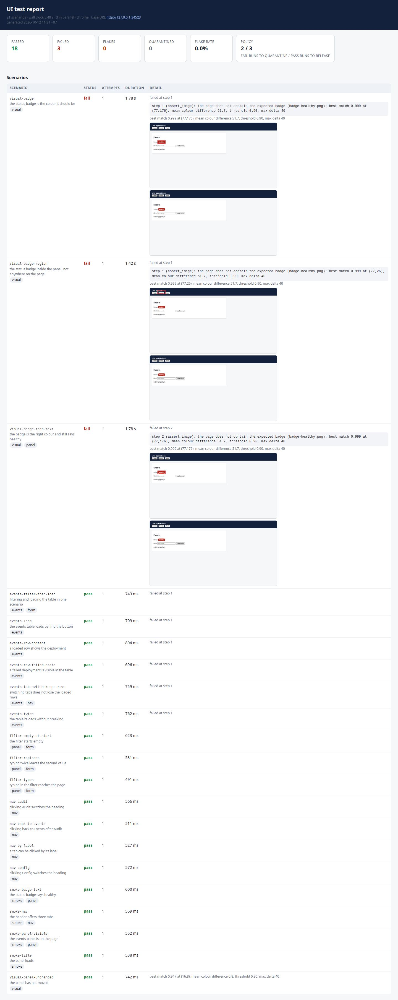
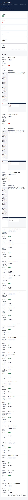

# UX review of the HTML report

2026-10-12, in a real browser (Chromium via Playwright) at 375, 390, 768, 1024 and 1440 px. Numbers come from computed
styles and geometry, not from opinion. The report under review is the one a broken run produces
(`scripts/measure-visual.sh` → 21 scenarios, 18 passed, 3 failed).

## Fixed

| severity | what the measurement showed | fix | after |
| --- | --- | --- | --- |
| critical | at 390 px the page was **444 px wider than the screen**: the five-column table was 810 px wide with no scroll container, the `Detail` column was cut off and scenario names wrapped onto six lines | below 600 px each row is a labelled card (`data-label` + `td::before`), between 600 px and that the table scrolls inside `.table-wrap`; images are capped at `min(460px, 100%)` instead of 460 px | overflow **0 px** at 375/390/768/1024/1440 |
| warning | a raw `time.Time` leaked into the page: `generated 2026-10-12T11:00:42.018581766 +0700 +07 m=+6.061539052` — the monotonic clock reading made it to the HTML | `{{.Data.Generated.Format "2006-01-02 15:04 MST"}}` in the header, the JSON keeps RFC 3339 | `generated 2026-10-12 11:21 +07`, zero occurrences of `m=+` |
| warning | five font sizes on the page (the stylesheet defined six: 11/12/14/16/20/22) | 11 px → 12 px, 22 px → 20 px | **four** sizes: 12/14/16/20 |
| suggestion | the base URL was a 17 px tap target, and a long URL wrapped badly | under 600 px the link is `inline-flex` with `min-height: 44px`; `overflow-wrap: anywhere` for the URL | 44 px on a phone, no overflow |
| suggestion | `<th>` had no `scope`, the table had no caption, and a long error string could not break | `scope="col"` on all five headers, `<caption class="sr-only">`, `overflow-wrap: anywhere` on `<pre>` | 5 headers scoped, 1 caption, verified in the DOM |

## Verified after the fix

| viewport | page overflow | smallest target | contrast failures | font sizes |
| --- | --- | --- | --- | --- |
| 375 / 390 | 0 px | 44 px | 0 | 4 |
| 768 / 1024 / 1440 | 0 px | 17 px (the header link, a mouse target) | 0 | 4 |

At 390 px the DOM confirms the card layout (`thead` hidden, `td` is `grid`, `td::before` is `"Scenario"`) and at 1440 px
the table layout is untouched (`td` is `table-cell`, `::before` is `none`). Behaviour is unchanged: the same run still
reports 21 scenarios · 18 passed · 3 failed, best match 0.999 at (77,176) with a mean colour difference of 51.7 against
a threshold of 40.
